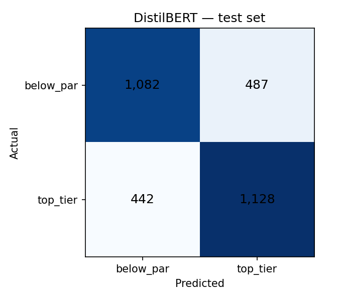
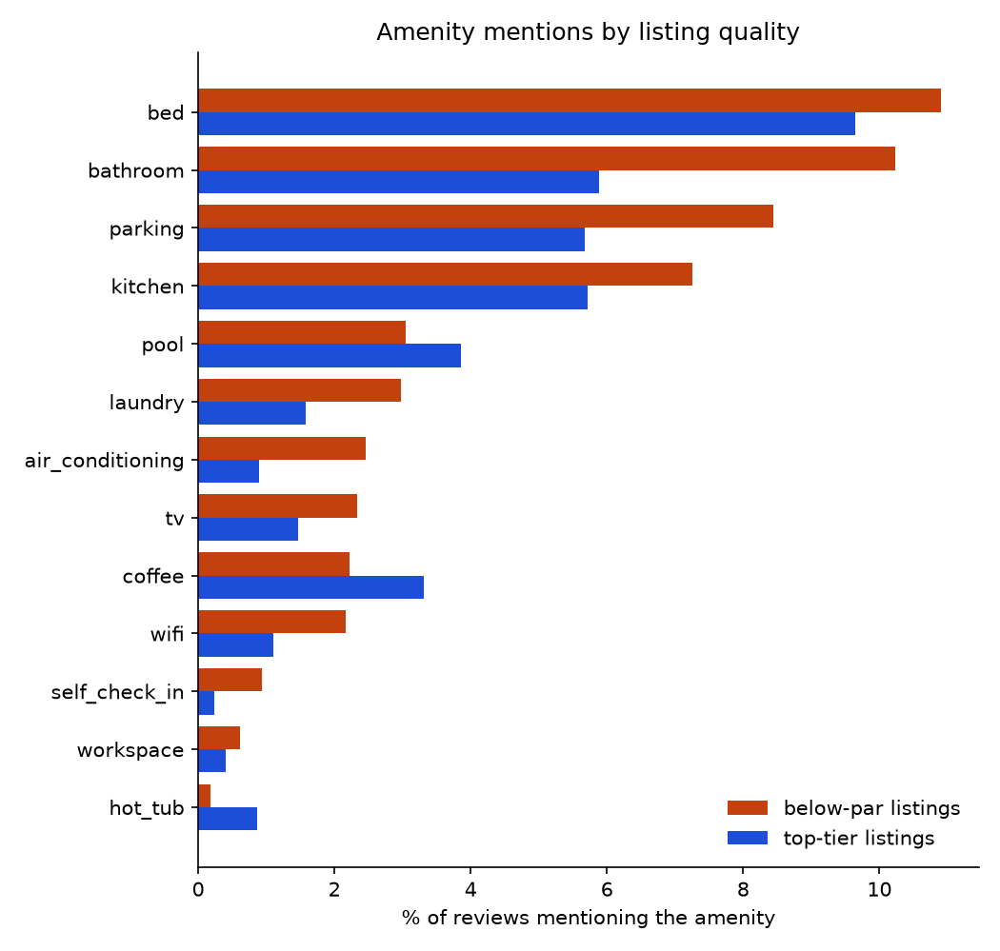
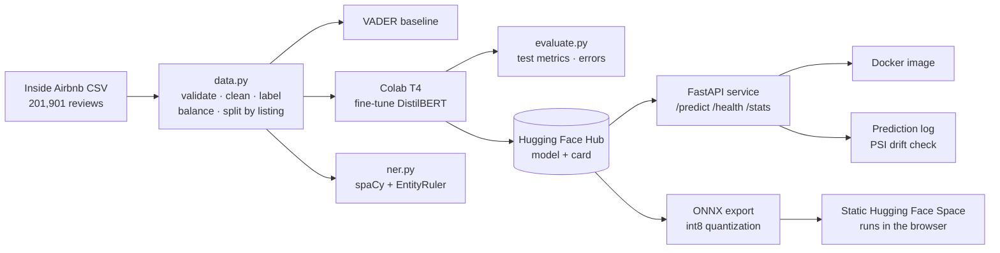

# Airbnb Review Quality: fine-tuned DistilBERT, from notebook to deployed API

[](https://github.com/sgaind-data/Airbnb_Review_Scores_ML/actions/workflows/ci.yml)
[](https://huggingface.co/sgaind-dataai/distilbert-airbnb-listing-quality)
[](https://huggingface.co/spaces/sgaind-dataai/airbnb-review-quality)
[](https://colab.research.google.com/github/sgaind-data/Airbnb_Review_Scores_ML/blob/main/notebooks/train_on_colab.ipynb)

**Can a guest's review tell a below-par Airbnb listing from a top-tier one?** This project fine-tunes
DistilBERT on 15,694 Dallas Airbnb reviews, beats a VADER sentiment baseline by **+9.6 points of macro F1**,
analyses amenity mentions with spaCy NER, and serves the model as a tested, monitored, containerised API.

**Try it:** [live demo](https://huggingface.co/spaces/sgaind-dataai/airbnb-review-quality). Paste a review and see the verdict.

**Author:** Sarika Gaind. Built entirely on free tools (Colab T4, Hugging Face Hub and Spaces, GitHub Actions).

## Results

Test set: 3,139 reviews from **446 listings the model never saw** (splits are grouped by listing).

| Model | Accuracy | Macro F1 | F1 below-par | F1 top-tier |
| --- | --- | --- | --- | --- |
| VADER (default threshold 0.05) | 0.547 | 0.436 | 0.187 | 0.686 |
| VADER (threshold tuned on validation, 0.88) | 0.608 | 0.608 | 0.597 | 0.618 |
| **DistilBERT (fine-tuned)** | **0.704** | **0.704** | **0.700** | **0.708** |



Validation macro F1 by epoch: 0.711 → 0.708 → **0.718** (best checkpoint kept). Validation loss rose while
F1 held, so extra epochs added confidence rather than accuracy. Training took about 3 minutes on a free T4.

## Key findings

1. **The labels, not the model, set the ceiling.** Every review inherits its listing's average rating, so a
   glowing review of a 4.5-rated listing is labelled "below-par". All 10 of the model's most confident errors
   ([reports/error_analysis.csv](reports/error_analysis.csv)) are reviews whose sentiment disagrees with the
   listing average, not misreadings of the text.
2. **The model learned to spot complaints.** Its confident "below-par" calls on top-rated listings quote dust,
   dirty sheets, price and value, and paid parking.
3. **Below-par listings are praised less enthusiastically, not criticised more.** Tuned VADER only works with a
   threshold of 0.88: reviews of weaker listings are still positive, just less effusive. Default VADER labels
   almost everything positive (F1 of 0.19 on below-par).
4. **Below-par reviews talk about the basics; top-tier reviews talk about the extras.** Self check-in (3.9×),
   air conditioning (2.8×), wifi (2.0×) and bathrooms (1.7×) come up far more in below-par reviews, often as
   complaints; hot tubs (4.8×) and coffee (1.5×) come up more in top-tier ones. Top-tier reviews name the host
   1.8× more often; below-par reviews mention money 5.5× more.

## Amenity analysis (spaCy NER)

`en_core_web_sm` plus an `EntityRuler` with 13 amenity categories ([configs/amenities.yaml](configs/amenities.yaml)),
run on all 15,694 reviews. Mentions preceded by a negation or complaint word ("no wifi", "dirty towels") are
counted separately. Full table: [reports/amenity_comparison.csv](reports/amenity_comparison.csv).



| Amenity | % of below-par reviews | % of top-tier reviews | Ratio | Negated in below-par | Negated in top-tier |
| --- | --- | --- | --- | --- | --- |
| Self check-in | 0.93 | 0.24 | 3.9× | 6.8% | 0% |
| Air conditioning | 2.46 | 0.89 | 2.8× | 7.8% | 0% |
| Wifi | 2.17 | 1.11 | 2.0× | **14.7%** | 0% |
| Laundry | 2.98 | 1.58 | 1.9× | 6.4% | 0.8% |
| Bathroom | 10.23 | 5.89 | 1.7× | **11.1%** | 1.7% |
| Parking | 8.44 | 5.68 | 1.5× | 5.6% | 1.8% |
| Coffee | 2.22 | 3.31 | 0.7× | 9.8% | 0.8% |
| Hot tub | 0.18 | 0.87 | 0.2× | 7.1% | 0% |

All rows differ significantly between the classes (chi-square, p < 0.001). Guests mention the AC, wifi or
check-in mostly when they fail; they mention hot tubs and coffee when they're delighted. The standard spaCy
entities agree: top-tier reviews name a **person** (usually the host) 1.8× more often, while below-par reviews
mention **money** 5.5× and **times** 1.9× more often, i.e. fees and waiting. This matches the model's confident
errors in [Key findings](#key-findings).

## Model optimisation (ONNX + int8)

[scripts/export_onnx.py](scripts/export_onnx.py) exports the model to ONNX, checks it against PyTorch (max logit
difference 6e-07), applies dynamic int8 quantization, and re-scores the full test set. Results in
[reports/onnx_metrics.json](reports/onnx_metrics.json):

| Version | Size | Accuracy | Macro F1 | Latency, 1 review (CPU) |
| --- | --- | --- | --- | --- |
| ONNX fp32 | 268 MB | 0.704 | 0.704 | 3.2 ms |
| **ONNX int8** | **67 MB** | **0.699** | **0.699** | **2.4 ms** |

Quantization makes the model 4× smaller for half a point of accuracy (the two versions agree on 95.6% of
test reviews). The int8 model is what the live demo runs in the browser with Transformers.js.

## Serving performance

Load test against the API ([scripts/load_test.py](scripts/load_test.py)): 200 requests, 8 concurrent clients,
one review per request, CPU only on a MacBook (Apple Silicon). Results in [reports/load_test.json](reports/load_test.json).

| Throughput | p50 latency | p95 latency | p99 latency | Errors |
| --- | --- | --- | --- | --- |
| 179 requests/s | 44 ms | 55 ms | 60 ms | 0 |

The drift check (`make drift`) compares live predictions with the test set using the Population Stability
Index. On load-test traffic (5 repeated sample reviews) it correctly reports significant drift (PSI 4.1).

## Architecture



## Engineering

| Area | What's in place |
| --- | --- |
| Data | Data contract with schema checks ([docs/DATA.md](docs/DATA.md)); explicit date format; manifest with the raw file's SHA-256 |
| Leakage | Train/val/test split grouped by listing (`StratifiedGroupKFold`), enforced by a test |
| Config | All settings in [configs/](configs/), none hard-coded |
| Training | Checkpoints to Google Drive every epoch with automatic resume; 1-minute smoke test before the full run |
| Tests | 30+ pytest tests: pipeline, metrics, baseline, NER statistics, API validation, monitoring |
| CI | GitHub Actions: lint (ruff) + tests, then builds the Docker image and smoke-tests the running container |
| API | FastAPI with input validation (1–32 texts, ≤ 5,000 chars), request IDs, structured access logs |
| Performance | 179 requests/s, p95 55 ms on a laptop CPU (see above) |
| Monitoring | `/stats` rolling window (volume, class share, p50/p95 latency); JSON-lines prediction log without raw text; PSI drift check against the test set |
| Deployment | CPU Docker image with the model baked in, non-root user, health check (built and smoke-tested in CI). Live demo: int8 ONNX model running client-side with Transformers.js on a free static Hugging Face Space |
| Model optimisation | ONNX export + dynamic int8 quantization ([scripts/export_onnx.py](scripts/export_onnx.py)); accuracy cost measured on the test set ([reports/onnx_metrics.json](reports/onnx_metrics.json)) |

## Quick start

```bash
python3.12 -m venv .venv && source .venv/bin/activate
make setup                 # install + spaCy model
make test                  # lint + unit tests
make data baseline ner     # needs data/raw/Dallas_Airbnb.csv (see docs/DATA.md)
make api                   # http://localhost:8000 (demo page), /docs for the API
```

```bash
curl -X POST localhost:8000/predict -H 'Content-Type: application/json' \
  -d '{"texts": ["Spotless and the host was lovely", "Dusty room and we paid extra for parking"]}'
```

Training runs on Colab's free GPU: open [notebooks/train_on_colab.ipynb](notebooks/train_on_colab.ipynb) and run the cells in order.

## Repository layout

```
configs/            data, training and amenity settings
src/airbnb_nlp/     data · baseline · train · evaluate · ner · inference · api · monitoring
tests/              unit tests (run in CI)
notebooks/          Colab notebook for GPU training, evaluation and publishing
scripts/            data profiling, load test, ONNX export
reports/            metrics, confusion matrix, error analysis, amenity analysis
docs/               data contract, model card
space/              static Hugging Face Space (browser demo)
original_analysis/  the original academic project (Random Forest on listing features)
```

## What I'd do differently from the original analysis

The original coursework (in `original_analysis/`) reported R² = 0.975 for a Random Forest. Rebuilding it
exposed issues that inflated that number, and this project fixes them:

- **Target leakage:** `review_scores_accuracy`, a sub-score of the rating being predicted, was used as a feature.
- **Group leakage:** reviews of the same listing landed in both train and test. Splits are now grouped by listing.
- **Preprocessing broke VADER:** NLTK stopword removal deletes "not", so "not clean" became "clean". VADER now gets raw text.
- **Preprocessing fit before the split,** and missing ratings filled with 0.
- **Only 4,500 of 201,901 reviews were used.**

## Limitations and next steps

- Listing-level labels are noisy. Next: score a listing by averaging its reviews' predictions, or use per-review star ratings.
- Dallas only, English only. Next: other Inside Airbnb cities to test generalisation.
- Serving: host the FastAPI container on a paid tier or a cloud VM when a public API is needed; the free demo runs the model in the browser instead.

## Data and licence

Data: [Inside Airbnb](https://insideairbnb.com), Dallas TX, June 2024, licensed CC BY 4.0. The raw data is not
stored in this repo. Code: MIT licence.
